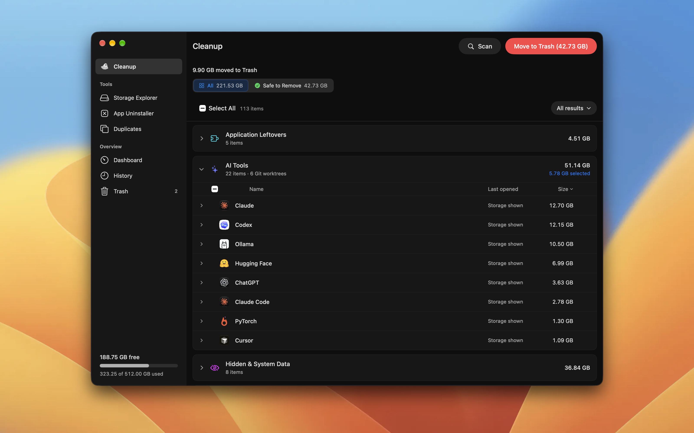

<p align="center">
  
</p>

<h1 align="center">Moppo</h1>

<p align="center">
  See what uses your disk space. Review what you remove.<br>
  A native macOS app, built with Swift and SwiftUI.
</p>

<p align="center">
  <a href="#install-on-a-mac">Install</a> &middot;
  <a href="#features-at-a-glance">Features</a> &middot;
  <a href="#your-data">Privacy</a> &middot;
  <a href="CHANGELOG.md">Changelog</a> &middot;
  <a href="#build-the-app">Build</a> &middot;
  <a href="#tested-apps-and-tools">Tested Apps and Tools</a> &middot;
  <a href="docs/README.md">Docs</a> &middot;
  <a href="https://github.com/anguria-studio/Moppo/issues">Issues</a>
</p>

<p align="center">
  <a href="https://github.com/anguria-studio/Moppo/releases/latest"></a>
  <a href="https://github.com/anguria-studio/Moppo/actions/workflows/ci.yml"></a>
  <a href="#install-on-a-mac"></a>
  <a href="#install-on-a-mac"></a>
  <a href="LICENSE"></a>
</p>

<p align="center">
  
</p>

**[Download Moppo for macOS](https://github.com/anguria-studio/Moppo/releases/latest/download/Moppo.dmg)**
 · macOS 15+ · Apple silicon and Intel · Signed and notarized

Or install with [Homebrew](https://brew.sh):

```sh
brew install --cask anguria-studio/tap/moppo
```

## Features at a glance

| Feature | What you can do |
| --- | --- |
| Cleanup | Review caches, application leftovers, Xcode data, developer folders, and Git worktrees. |
| AI Tools | Review AI tool storage, Codex sessions, worktrees, and local models. Models in use stay protected. |
| Dashboard | See disk usage and compare changes between saved measurements. |
| Storage Explorer | Browse folders with a table and treemap. |
| Duplicates | Compare file contents or find identical and similar photos. |
| App Uninstaller | Review applications and related files. Remove Homebrew packages through Homebrew. |
| Docker images and volumes | Review unused images and volumes and remove them through Docker. |
| History and Put Back | Review removal results and restore eligible items from the Trash. |
| Everyday controls | Set exclusions, scan schedules, low-space alerts, and menu bar mode. |
| Command line | Scan, save cleanup plans, and remove items from Terminal or an AI agent. |

See the [user guide](docs/user-guide.md) for filters, file access, settings, and removal behavior.

## Install on a Mac

1. [Download the disk image](https://github.com/anguria-studio/Moppo/releases/latest/download/Moppo.dmg).
2. Open the disk image.
3. Drag **Moppo** to **Applications**.
4. Open Moppo.
5. Follow the welcome guide to review file access.

The Homebrew command above installs the same signed and notarized disk image.
Use the full cask name as shown.

Use **Moppo > Check for Updates…** to check for a new version.
Moppo checks for updates automatically. You can turn off automatic checks in **Settings > Updates**.

## Removal and recovery

| Before removal | What to know |
| --- | --- |
| Reported sizes | Shared storage can reduce the space that removal recovers. |
| Put Back | Recovery requires a saved receipt and the item still in the Trash. |
| Permanent removal | Put Back cannot restore Homebrew packages, Docker images, Docker volumes, tool command removals, or permanently deleted items. |
| Photos | With iCloud Photos enabled, deletion affects the linked library and its other devices. |

Read the [removal and Put Back guide](docs/user-guide.md#removal-and-put-back) for confirmation, permission, and recovery details.

## Your data

Scans run locally. Moppo stores scan caches, preferences, and cleanup history on your Mac.
Photo previews and originals can download from iCloud. Controls are in **Settings > Advanced**.
macOS manages file and Photos access.

Install the `moppo` command and the agent skill from **Settings > Advanced**.
Read the [CLI guide](docs/cli.md) and the [agent workflow](docs/agent-workflow.md) for details.

Read the [privacy policy](https://anguria.studio/moppo/privacy/) and [terms of use](https://anguria.studio/moppo/terms/).

## Build the app

Moppo uses Swift 6, SwiftUI, and XcodeGen.
See the [build and test guide](docs/building.md) for requirements, signing, commands, and CI checks.

## Tested Apps and Tools

Checks cover specific storage paths and tool versions.

<table>
  <tr>
    <th align="left" width="180">Desktop apps</th>
    <td width="540">
      <a href="docs/ai-storage.md" title="ChatGPT / Codex desktop: Cache removal and application recovery"><picture><source media="(prefers-color-scheme: dark)" srcset="docs/images/tools/chatgpt-dark.png"></picture></a>&nbsp;
      <a href="docs/ai-storage.md" title="Claude desktop: Cache removal and account recovery"></a>&nbsp;
      <a href="docs/ai-storage.md" title="Cursor desktop: Cache removal, uninstall, and Put Back"></a>&nbsp;
    </td>
  </tr>
  <tr>
    <th align="left" width="180">Sessions and projects</th>
    <td width="540">
      <a href="docs/ai-storage.md" title="Codex CLI: Worktree removal and Put Back"></a>&nbsp;
      <a href="docs/tool-catalog.md" title="Composer: Project vendor removal and package reinstall"></a>&nbsp;
    </td>
  </tr>
</table>

Checks used Moppo scans with tool commands or manual Trash moves.

<table>
  <tr>
    <th align="left" width="180">Languages and builds</th>
    <td width="540">
      <a href="docs/tool-catalog.md" title="Go, goenv, gopls, golangci-lint"></a>&nbsp;
      <a href="docs/tool-catalog.md" title="Cargo, rustup, sccache"><picture><source media="(prefers-color-scheme: dark)" srcset="docs/images/tools/cargo-dark.svg"></picture></a>&nbsp;
      <a href="docs/tool-catalog.md" title="Bundler, ruby-install"></a>&nbsp;
      <a href="docs/tool-catalog.md" title="Composer"></a>&nbsp;
      <a href="docs/tool-catalog.md" title="Maven"></a>&nbsp;
      <a href="docs/tool-catalog.md" title="sbt, Coursier"></a>&nbsp;
      <a href="docs/tool-catalog.md" title="Kotlin/Native"></a>&nbsp;
      <a href="docs/tool-catalog.md" title="cpanm, plenv"></a>&nbsp;
      <a href="docs/tool-catalog.md" title="cabal, Stack"></a>&nbsp;
      <a href="docs/tool-catalog.md" title="NuGet"><picture><source media="(prefers-color-scheme: dark)" srcset="docs/images/tools/nuget-dark.svg"></picture></a>&nbsp;
    </td>
  </tr>
  <tr>
    <th align="left" width="180">Python</th>
    <td width="540">
      <a href="docs/tool-catalog.md" title="pre-commit, pipx"></a>&nbsp;
    </td>
  </tr>
  <tr>
    <th align="left" width="180">Containers and versions</th>
    <td width="540">
      <a href="docs/tool-catalog.md" title="Podman"></a>&nbsp;
      <a href="docs/tool-catalog.md" title="Lima"></a>&nbsp;
      <a href="docs/tool-catalog.md" title="asdf, mise"></a>&nbsp;
    </td>
  </tr>
</table>

Checks cover storage recognition, measurement, and refusal of removal.

<table>
  <tr>
    <th align="left" width="180">AI coding tools</th>
    <td width="540">
      <a href="docs/ai-storage.md" title="Claude Code"></a>&nbsp;
      <a href="docs/ai-storage.md" title="Cursor CLI"></a>&nbsp;
      <a href="docs/ai-storage.md" title="T3 Code"></a>&nbsp;
      <a href="docs/ai-storage.md" title="GitHub Copilot CLI"><picture><source media="(prefers-color-scheme: dark)" srcset="docs/images/tools/copilot-dark.svg"></picture></a>&nbsp;
      <a href="docs/ai-storage.md" title="OpenCode"></a>&nbsp;
      <a href="docs/ai-storage.md" title="Goose"></a>&nbsp;
      <a href="docs/ai-storage.md" title="OpenClaw"></a>&nbsp;
      <a href="docs/ai-storage.md" title="Kiro"></a>&nbsp;
      <a href="docs/ai-storage.md" title="Devin"></a>&nbsp;
      <a href="docs/ai-storage.md" title="Gemini CLI"></a>&nbsp;
      <a href="docs/ai-storage.md" title="Antigravity"></a>&nbsp;
    </td>
  </tr>
  <tr>
    <th align="left" width="180">AI desktop tools</th>
    <td width="540">
      <a href="docs/ai-storage.md" title="AnythingLLM"></a>&nbsp;
      <a href="docs/ai-storage.md" title="Cherry Studio"></a>&nbsp;
      <a href="docs/ai-storage.md" title="Comfy Desktop"></a>&nbsp;
      <a href="docs/ai-storage.md" title="Stability Matrix"></a>&nbsp;
    </td>
  </tr>
  <tr>
    <th align="left" width="180">Model storage</th>
    <td width="540">
      <a href="docs/ai-storage.md" title="Ollama"></a>&nbsp;
      <a href="docs/ai-storage.md" title="Hugging Face"></a>&nbsp;
      <a href="docs/ai-storage.md" title="LM Studio"></a>&nbsp;
    </td>
  </tr>
  <tr>
    <th align="left" width="180">Databases</th>
    <td width="540">
      <a href="docs/tool-catalog.md" title="PostgreSQL, Postgres.app"></a>&nbsp;
      <a href="docs/tool-catalog.md" title="MySQL"><picture><source media="(prefers-color-scheme: dark)" srcset="docs/images/tools/mysql-dark.svg"></picture></a>&nbsp;
      <a href="docs/tool-catalog.md" title="MongoDB"></a>&nbsp;
      <a href="docs/tool-catalog.md" title="Redis"></a>&nbsp;
      <a href="docs/tool-catalog.md" title="DBeaver"></a>&nbsp;
      <a href="docs/tool-catalog.md" title="DBngin, OpenSearch"></a>&nbsp;
    </td>
  </tr>
</table>

See the [AI storage rules](docs/ai-storage.md) and [developer tool storage catalog](docs/tool-catalog.md) for full coverage and limits.

## Documentation and contributing

| Guide | Contents |
| --- | --- |
| [User guide](docs/user-guide.md) | Permissions, Cleanup filters, settings, removal, recovery, and updates |
| [CLI guide](docs/cli.md) | The `moppo` command, JSON output, and saved cleanup plans |
| [Documentation index](docs/README.md) | Every guide, grouped for users, contributors, storage rules, and releases |
| [Architecture](docs/architecture.md) | Source layout, state ownership, measurement rules, and current limits |
| [Build and test](docs/building.md) | Development setup and required checks |
| [Release packages](docs/distribution.md) | Signing, notarization, and packaging |
| [Writing style](WRITING_STYLE.md) | Rules for documentation, interface text, and code comments |
| [Project instructions](AGENTS.md) | Repository guidance and contribution rules |

Open an [issue](https://github.com/anguria-studio/Moppo/issues) before a large change.
For bug reports, include the expected behavior and steps to reproduce the problem.
Remove private file paths and personal photos from reports.
Run the relevant tests and writing checks before you submit a pull request.

For support, use **Help > Report a Problem…** or email [hello@anguria.studio](mailto:hello@anguria.studio).
Review the generated report before you send it.

## Credits and license

Moppo uses protection lists from [Purge](https://github.com/jithin-sabu/purge-app), by Jithin Sabu.
Purge also informed the original Ollama manifest reader.
[Sparkle](https://sparkle-project.org/) provides application updates.

Moppo uses the [MIT License](LICENSE).
See [Third-party notices](THIRD_PARTY_NOTICES.md) for source details and license notices.
